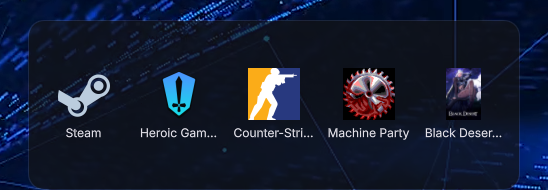

# Quick Shortcuts

A desktop widget for [DankMaterialShell](https://github.com/AvengeMedia/DankMaterialShell) that shows a clean grid of app shortcuts. The widget itself has no buttons or headers, only your apps.



## Features

- Left-click an icon to launch the app. Launching goes through DMS's own launcher path (`SessionService.launchDesktopEntry`), so your launch prefix, per-app overrides (dGPU, extra flags, environment) and terminal apps behave the same as in the DMS launcher and dock.
- Shortcuts are managed in **Settings → Desktop Widgets → Quick Shortcuts**: add apps with the DMS app picker, remove them, and change their order.
- Each widget instance has its own list, so you can place several widgets with different apps.
- Adjustable icon size, background opacity (set it to 0 for icons only) and app name labels.
- The grid stays centred and scrolls when there are more apps than fit.
- An empty widget opens the Desktop Widgets settings when clicked.
- English and Turkish UI.

Move and resize the widget the usual DMS way: right-click and drag it, or right-click and drag its bottom-right corner.

## Installation

From the DMS plugin browser: **Settings → Desktop Widgets → Browse Plugins**, search for *Quick Shortcuts*, then add the widget.

Manually:

```bash
git clone https://github.com/KadirJeager/dms-quick-shortcuts ~/.config/DankMaterialShell/plugins/quickShortcuts
```

Then restart DMS (or run `dms ipc call plugins reload quickShortcuts`) and add it with **Settings → Desktop Widgets → Add Widget**.

## Custom icons

A shortcut normally uses the icon of its `.desktop` entry. To use a different image, set `iconOverride` on that shortcut in the widget's instance config in `~/.config/DankMaterialShell/settings.json` (`desktopWidgetInstances[].config.shortcuts[]`), for example:

```json
{ "name": "Counter-Strike 2", "desktopId": "Counter-Strike 2", "iconOverride": "~/.local/share/icons/hicolor/512x512/apps/counter-strike-2.png" }
```

## Requirements

DankMaterialShell 1.6.0 or newer. No external dependencies.

## License

MIT
